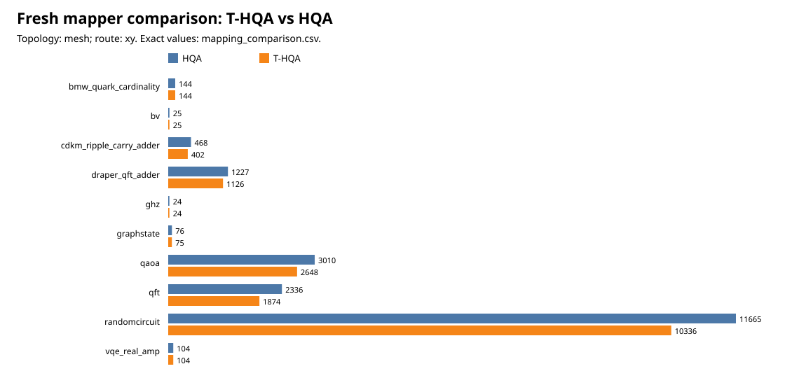

# Fresh mapper audit — 2026-10-25

This is the first fresh artifact in the Golden study. It maps the frozen 48-qubit
QASM corpus—not a historical adjacent-hop trace—with the current vendored mapper.
It is mapper evidence only; no ACE scheduler result is inferred from it.

## What was generated and checked

- 10 frozen QASM inputs, recovered from the historical archive and SHA-256
  verified.
- T-HQA and HQA, each with mapper/reliability seeds 42, 43, and 44.
- Mesh: XY, YX, shortest-reliable, and maximum-reliability routes.
- Torus: Dijkstra only.
- 120 exact `Partition` placement contracts and 300 derived route artifacts.

`tools/golden_study/audit_mappings.py` independently checked each route artifact's
placement hash, input-QASM hash, endpoint replay fields, core bounds, physical
adjacency, migration count, and hop count. All **300/300** passed. The raw audit is
[`mapping_audit.csv`](../../../results/golden_study_2026-10-25/validation/mapping_audit.csv);
the per-route aggregation is
[`mapping_summary.csv`](../../../results/golden_study_2026-10-25/validation/mapping_summary.csv).

## HQA versus T-HQA: mesh XY control

The graph is backed by the exact
[`mapping_comparison.csv`](../../../results/golden_study_2026-10-25/tables/mesh_xy_hqa_vs_thqa/mapping_comparison.csv).
Across these ten inputs, T-HQA has 7,702 logical migrations and 16,758 XY hops,
versus HQA's 7,587 migrations and 19,079 hops: **2,321 fewer hops (12.17%)** but
115 more migrations. That is a mapper-level trade-off, not proof that T-HQA has
lower ACE latency. The ACE runs must still hold the same route trace fixed per
policy and measure waiting, readiness, waste, and fidelity.

The exact per-workload values are in the linked CSV. The strongest hop reductions
are QFT (2,336 to 1,874) and random circuits (11,665 to 10,336); several sparse
workloads are unchanged. We therefore retain HQA as a control rather than claiming
that T-HQA is uniformly superior.

## Critical seed result

For every workload, algorithm, and topology, the three declared mapper/reliability
seeds produced **one distinct placement partition**, not three. This is explicit in
[`mapping_partition_variation.csv`](../../../results/golden_study_2026-10-25/validation/mapping_partition_variation.csv).
The reliability map can still change reliability-aware *routes* (especially
maximum-reliability), but the placement is identical. Consequently these three
seeds must never be presented as independent mapping replications. They are route/
hardware-realisation checks. Independent mapping replication requires an explicitly
different circuit instance, initial placement, or algorithm configuration.

## Next gate

The fresh T-HQA mesh-XY contracts are ready to become the candidate ACE input
inventory. Before simulations, the study must lock its physics training/evaluation
seeds, physical configuration hash, and the precise baseline-cache quota semantics
identified in the scheduler audit. This prevents a mapper result from being mixed
with a differently configured ODG/CGP/ACGP/Dynamic scheduler run.
