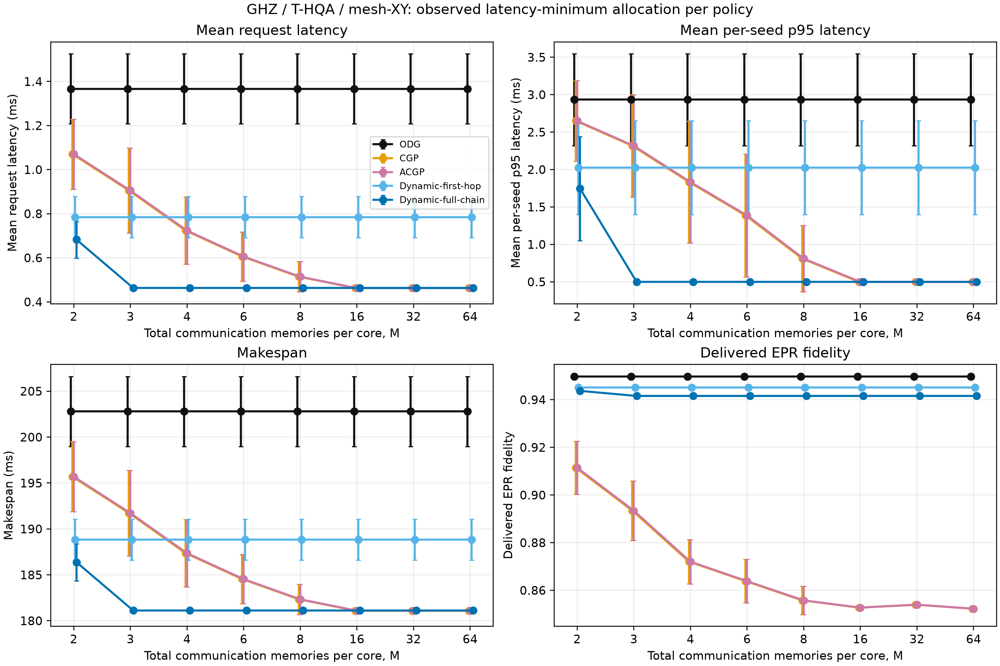
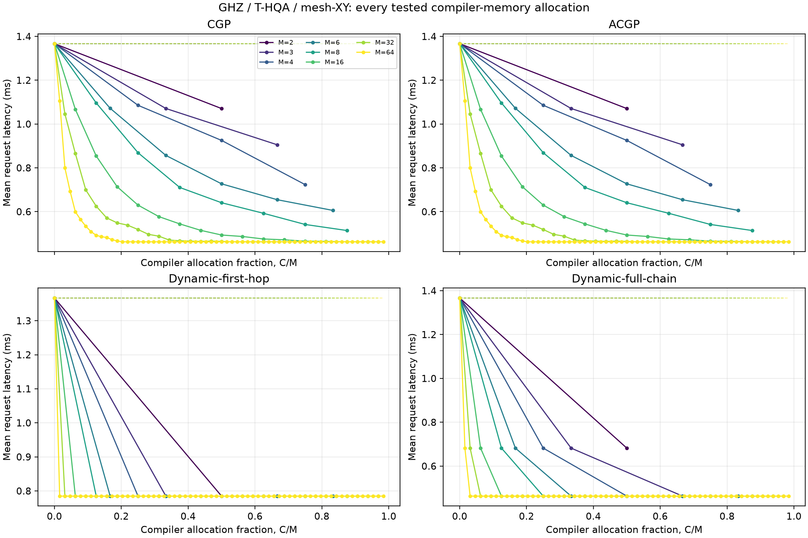

# Execution progress — 2026-10-26

The accepted raw outputs are under
[`raw/base-evaluation`](../../../results/golden_study_2026-10-25/raw/base-evaluation).
The incremental machine-readable aggregation is
[`base-evaluation-progress.csv`](../../../results/golden_study_2026-10-25/summaries/base-evaluation-progress.csv),
and the denominator/progress counters are in
[`base-evaluation-progress.json`](../../../results/golden_study_2026-10-25/validation/base-evaluation-progress.json).

## First accepted slice: zero-cache invariant

GHZ, T-HQA, mesh XY, total communication memories `M=2`, compiler/cache allocation
`C=0`, and evaluation seeds 0--29 are complete. ODG, CGP, ACGP, Dynamic full-chain,
and Dynamic first-hop agree exactly for every seed on request mean and p95 latency,
makespan, admission wait, fidelity, retries, and generated/used/unused pair counts.

| Policy | Seeds | Request latency, mean ± SD | Per-seed p95, mean ± SD | Makespan, mean ± SD |
| --- | ---: | ---: | ---: | ---: |
| ODG | 30 | 1.36684 ± 0.15897 ms | 2.93341 ± 0.61272 ms | 202.80409 ± 3.81518 ms |
| CGP | 30 | 1.36684 ± 0.15897 ms | 2.93341 ± 0.61272 ms | 202.80409 ± 3.81518 ms |
| ACGP | 30 | 1.36684 ± 0.15897 ms | 2.93341 ± 0.61272 ms | 202.80409 ± 3.81518 ms |
| Dynamic full-chain | 30 | 1.36684 ± 0.15897 ms | 2.93341 ± 0.61272 ms | 202.80409 ± 3.81518 ms |
| Dynamic first-hop | 30 | 1.36684 ± 0.15897 ms | 2.93341 ± 0.61272 ms | 202.80409 ± 3.81518 ms |

This is a boundary correctness result, not a performance ranking: at zero cache
capacity every pre-generation policy must fall back to on-demand behavior.

## First positive-cache comparison

The same trace at `M=2,C=1` is also complete. ODG remains the `C=0` baseline by
definition.

| Policy | Request latency, mean ± SD | Change vs ODG | Per-seed p95, mean | Makespan, mean | Fidelity, mean | Waste |
| --- | ---: | ---: | ---: | ---: | ---: | ---: |
| ODG | 1.36684 ± 0.15897 ms | reference | 2.93341 ms | 202.80409 ms | 0.94981 | 0% compiler waste |
| CGP | 1.07072 ± 0.15880 ms | −21.66% | 2.65007 ms | 195.69717 ms | 0.91146 | 7.0575% protocol waste |
| ACGP | 1.07072 ± 0.15880 ms | −21.66% | 2.65007 ms | 195.69717 ms | 0.91146 | 7.0575% protocol waste |
| Dynamic first-hop | 0.78488 ± 0.09312 ms | −42.58% | 2.02673 ms | 188.83701 ms | 0.94509 | 0% protocol/compiler waste |
| Dynamic full-chain | 0.68209 ± 0.08403 ms | −50.10% | 1.74672 ms | 186.37024 ms | 0.94372 | 0% protocol/compiler waste |

For this sparse GHZ cell, full-chain Dynamic is best on latency and makespan.
Dynamic also retains substantially higher fidelity than CGP/ACGP. This is not yet
a general claim: congested workloads, other routes, and the remaining memory sweep
must be completed before selecting a policy.

## Complete GHZ / T-HQA / mesh-XY memory sweep

The full registered slice is now complete: 278 runner jobs, 16,440 policy-seed
evaluations, eight total-memory values (`M = 2, 3, 4, 6, 8, 16, 32, 64`), every
integer compiler allocation `C = 0, ..., M-1`, five policy labels, and 30 paired
physics seeds. Every simulator request completed. This is 0.9091% of the complete
ten-workload, five-route base matrix.

The complete 548-row aggregation is in
[`base-evaluation-progress.csv`](../../../results/golden_study_2026-10-25/summaries/base-evaluation-progress.csv).
The 40-row descriptive envelope is in
[`ghz_thqa_mesh_xy_memory_sweep_observed_minima.csv`](../../../results/golden_study_2026-10-25/summaries/ghz_thqa_mesh_xy_memory_sweep_observed_minima.csv).
The envelope selects the lowest observed 30-seed mean latency for each `(M, policy)`
and resolves an exact tie using the smallest `C`. It is descriptive; it does not use
these evaluation seeds to train or freeze a new policy.

| Total memories `M` | Lowest observed policy | Smallest tied `C` | Mean latency | Change vs ODG | Fidelity |
| ---: | --- | ---: | ---: | ---: | ---: |
| 2 | Dynamic full-chain | 1 | 0.68209 ms | −50.10% | 0.94372 |
| 3 | Dynamic full-chain | 2 | 0.46320 ms | −66.11% | 0.94159 |
| 4 | Dynamic full-chain | 2 | 0.46320 ms | −66.11% | 0.94159 |
| 6 | Dynamic full-chain | 2 | 0.46320 ms | −66.11% | 0.94159 |
| 8 | Dynamic full-chain | 2 | 0.46320 ms | −66.11% | 0.94159 |
| 16 | CGP and ACGP (exact tie) | 14 | 0.46250 ms | −66.16% | 0.85274 |
| 32 | CGP and ACGP (exact tie) | 17 | 0.46250 ms | −66.16% | 0.85396 |
| 64 | CGP and ACGP (exact tie) | 13 | 0.46250 ms | −66.16% | 0.85229 |

The high-capacity CGP/ACGP advantage over Dynamic full-chain is only 0.00069 ms
(about 0.15%) in mean latency, while Dynamic full-chain delivers about 0.089 higher
absolute mean fidelity and needs only `C=2`. Dynamic full-chain reaches 100%
intended-request hit rate, zero on-demand fallback, and zero observed compiler or
protocol waste at `C=2`. Dynamic first-hop saturates at `C=1`, but prepares only
62.5% of requests and falls back on demand for 37.5%, so its mean latency remains
0.78488 ms. CGP and ACGP are numerically identical on this sparse trace except for
a small waste difference at `M=3,C=2`; this must not be generalized to congested
workloads.

## Launcher incident retained

The first attempt exposed a reproducibility bug: resolving the explicit virtualenv
interpreter path dereferenced it to system Python, losing the installed SeQUeNCe
package. The failure evidence is retained under
[`validation/launcher_failures`](../../../results/golden_study_2026-10-25/validation/launcher_failures).
The launcher now preserves virtualenv identity, and the same job completed and was
subsequently accepted through the resume-validation path.
