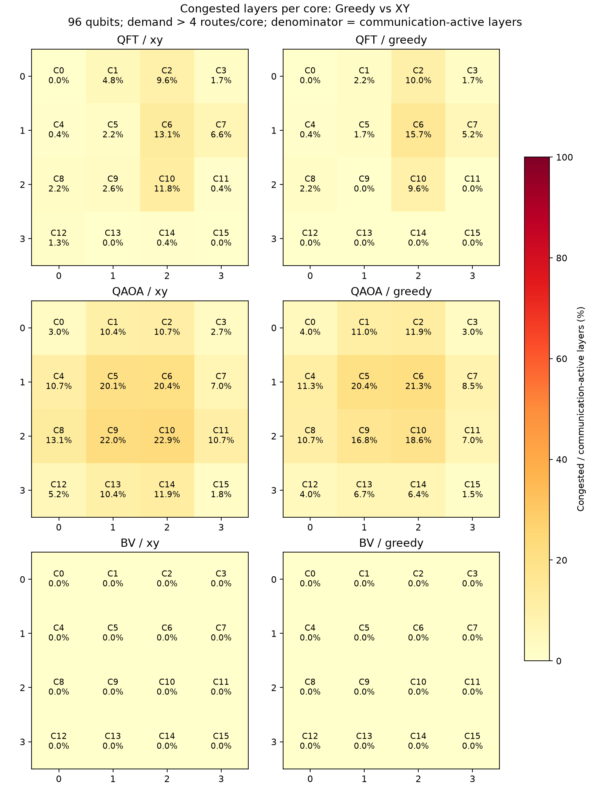

# Greedy versus XY: QFT, QAOA and BV, 2026-10-30

Fresh 96-qubit MQT Bench circuits, T-HQA/OEE mapping seed 42, circuit seed 42,
4x4 mesh, eight data slots and four communication memories/core. Each workload
is generated and mapped once; both routes preserve the same migrations and
placements. Both use shortest paths. Physics seeds 60–63, compiler C=4,
all-chain preparation, two-layer lead, ready-first admission, native handoff,
50 ms compiler reservation cap and zero artificial pregeneration buffer.
SeQUeNCe 0.8.1 is pinned to cf5283cdfd6692a82a090d15fb09fbc01bd322fc.
All 48 trials completed every request and passed runtime audits.

BV uses the linked MQT benchmark's default static layout and alternating hidden
string, with 96 total qubits including its flag. Final measurements are removed
and circuits normalized to rz/sx/x/cx before mapping; normalized circuit and
factory source hashes are retained. QAOA parameters follow the factory defaults
and parameter binding seed recorded in its input manifest.

## Compiler-driven C=4

Values are mean ± sample standard deviation across four physics seeds; fidelity
is the mean delivered EPR fidelity, not a circuit success probability.

| Workload | Route | Mean hop latency (ms) | Makespan (s) | Delivered EPR fidelity |
| --- | --- | ---: | ---: | ---: |
| qft | xy | 0.6395 ± 0.0070 | 3.2721 ± 0.0156 | 0.93579 |
| qft | greedy | 0.6347 ± 0.0060 | 3.2729 ± 0.0076 | 0.93568 |
| qaoa | xy | 1.1071 ± 0.0155 | 3.8435 ± 0.0271 | 0.93820 |
| qaoa | greedy | 1.0486 ± 0.0086 | 3.7476 ± 0.0349 | 0.93795 |
| bv | xy | 0.4458 ± 0.0000 | 1.5857 ± 0.0000 | 0.93241 |
| bv | greedy | 0.4458 ± 0.0000 | 1.5857 ± 0.0000 | 0.93253 |

## ODG on the same routes

| Workload | Route | Mean hop latency (ms) | Makespan (s) | Delivered EPR fidelity |
| --- | --- | ---: | ---: | ---: |
| qft | xy | 1.3324 ± 0.0106 | 3.8453 ± 0.0218 | 0.94981 |
| qft | greedy | 1.3358 ± 0.0128 | 3.8172 ± 0.0222 | 0.94981 |
| qaoa | xy | 1.3888 ± 0.0117 | 4.0605 ± 0.0272 | 0.94981 |
| qaoa | greedy | 1.3619 ± 0.0126 | 4.0470 ± 0.0281 | 0.94981 |
| bv | xy | 1.3584 ± 0.1168 | 1.6076 ± 0.0028 | 0.94981 |
| bv | greedy | 1.4615 ± 0.2029 | 1.6101 ± 0.0049 | 0.94981 |

## Static congestion

| Workload | Route | Hops | Excess demand above 4 | Overloaded core-layers | Layers with any overloaded core (%) |
| --- | --- | ---: | ---: | ---: | ---: |
| qft | xy | 3833 | 184 | 131 | 24.02 |
| qft | greedy | 3833 | 153 | 112 | 23.14 |
| qaoa | xy | 7913 | 1016 | 600 | 51.83 |
| qaoa | greedy | 7913 | 834 | 535 | 50.61 |
| bv | xy | 24 | 0 | 0 | 0.00 |
| bv | greedy | 24 | 0 | 0 | 0.00 |

Each heatmap cell divides that core's overloaded layers by all network
communication-active layers. This is static route demand, not measured queue
occupancy. A relay counts once per route here. Zero overload does not mean zero
traffic. See aggregate.csv for measured admission waiting and p95 hop latency.

## Interpretation

- qft: Greedy changes compiler mean hop latency by -0.76% and makespan by +0.02% relative to XY.
- qaoa: Greedy changes compiler mean hop latency by -5.29% and makespan by -2.50% relative to XY.
- bv: Greedy changes compiler mean hop latency by +0.00% and makespan by +0.00% relative to XY.

Fewer static overloads need not produce proportional runtime gains. BV has sparse
communication and no overload under either route, so there is no congestion
bottleneck for Greedy to remove. Makespan is the simulator's workload completion
clock, including a 5 ms gap per empty logical layer. BV has 316 empty layers,
so roughly 1.58 seconds of its makespan comes from this fixed gap. It is not a hardware circuit
execution prediction. Latency is eligibility to EPR delivery, including admission,
control and retries. No preparation window is subtracted; data teleportation,
local gate execution and data-memory occupancy are not modeled. One mapping per
workload and four physics seeds do not establish mapping-independent superiority.
These are fresh inputs, not the frozen inputs in the previous routing report.

## Evidence

`all_seeds.csv`, `aggregate.csv`, `congestion.csv` and `audits.json` retain derived
measurements. The dated evidence archive retains input circuits/mappings, source
hashes, routed traces, exact simulation commands, timing records and all audits.
The BV source is https://github.com/munich-quantum-toolkit/bench/blob/main/src/mqt/bench/benchmarks/bv.py.

[Raw evidence and reproduction files](../../../../results/greedy_xy_2026-10-30/README.md).
