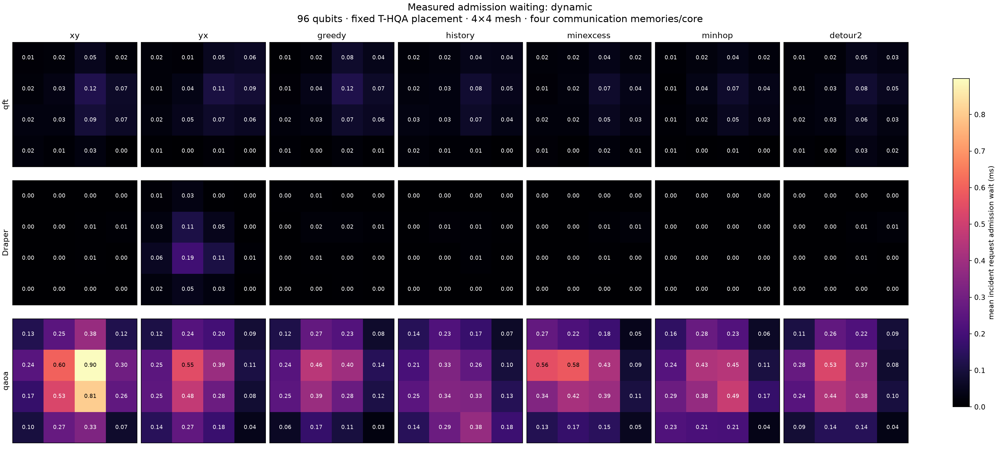
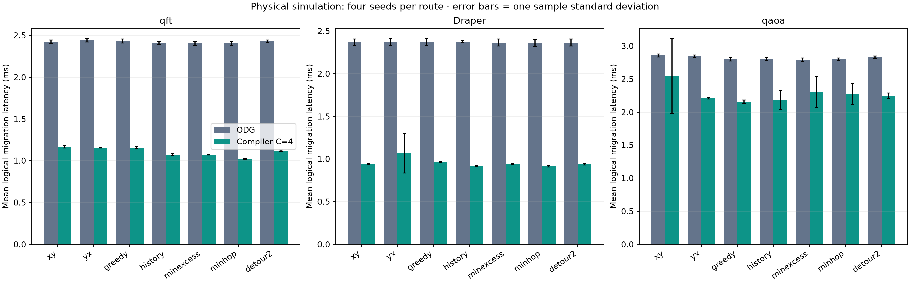

# Heavy-workload routing: QFT, Draper and QAOA

**Configuration and scope:** these frozen measurements use direct compiler-memory
handoff, again the default after source-backed research. The recorded "migration"
latency aggregates sequential hop EPR-service intervals; it does not include a
data-teleportation circuit or destination data-memory transfer. See the
[memory-lifecycle research](../../compiler-pregeneration/pair-consumption-research-2026-10-28.md)
and the distinct [extra-slot experiment](../../compiler-pregeneration/extra-memory-revert-2026-10-28.md).

**Recommendation:** use memory-weighted shortest-path optimization (`minhop`)
for QFT and Draper. Use congestion-aware greedy shortest paths (`greedy`) as
an inexpensive general default, especially for QAOA. The two are close overall;
this study does not establish one universal winner.

The study compares **seven routing strategies on complete 96-qubit circuits**:
XY, YX, congestion-aware greedy, history-aware greedy, joint route-excess
minimization, joint hop-incidence minimization, and joint optimization allowing
two extra hops. It runs the corrected compiler C=4 and ODG on the same paths,
placements and physical configuration. The primary comparison uses four
simulator seeds per combination (168 trials); fresh QAOA seeds add 24 trials.

## Best choices by workload

Primary seeds 60–63; means across four complete trials. These selected routes
are all shortest paths. Hop latency is eligibility to completion, including
admission waiting, control, retries and consumption. **No pre-generation window
is subtracted.**

| Workload | Recommended route | Compiler mean hop, ms | ODG mean hop on same route, ms | Compiler completion, s |
| --- | --- | ---: | ---: | ---: |
| QFT | `minhop` | 0.5595 | 1.3220 | 3.1811 |
| Draper QFT adder | `minhop` | 0.5038 | 1.3006 | 3.7764 |
| QAOA | `greedy` | 1.0508 | 1.3619 | 3.7543 |

Compared with compiler XY routing, these choices reduce mean hop latency by
**12.5%, 2.6%, and 15.2%**, respectively. On the selected paths, compiler mean
latency is **57.7%, 61.3%, and 22.8% below ODG**. Workload completion improves
less because it includes the existing layer barriers and empty-layer timing.

The best primary aggregate completion score belongs to `greedy`: its
equal-workload geometric mean is 0.98092 times XY, versus 0.98265 for `minhop`.
That is only a **0.18% difference between the two leaders**, not a decisive
universal performance margin. Fresh QAOA seeds 64–67 give 3.7957 s for greedy
and 3.7870 s for minhop, reinforcing the near-tie rather than proving one always
wins. Routes and heuristic weights were frozen before these fresh-seed trials.

| Fresh QAOA seeds 64–67 | Compiler mean hop, ms | Compiler completion, s (mean ± sample SD) |
| --- | ---: | ---: |
| XY | 1.1139 | 3.8457 ± 0.0447 |
| Greedy | 1.0962 | 3.7957 ± 0.0619 |
| Minhop | 1.0909 | 3.7870 ± 0.1253 |

The fresh-seed completion gains over XY are **1.3% and 1.5%**, respectively.
Thus the larger primary QAOA improvement should not be treated as a guaranteed
gain. Greedy has lower completion-time variation here and in the primary trials;
minhop has a slightly lower fresh-seed mean.

## What the congestion analysis explains

**Relay memory demand matters for full-chain pre-generation.** A route-count
objective counts an intermediate core once, while preparing incoming and
outgoing hops can require two pairs there. `minhop` uses hop-endpoint incidences:
endpoints count once and relays twice. It jointly chooses shortest paths to
minimize demand above the four-memory threshold. On QFT, this reduces incidence
excess from **875 to 498**, without adding any hops, and produces the lowest
measured QFT latency. Draper incidence excess falls from 50 to 12, even though
its route-count overload was already almost zero.

**Minimizing a static congestion score does not minimize runtime.** On QAOA,
route-excess minimization reduces excess from 1,016 to 584; allowing detours
reduces it further to 504. Nevertheless, their primary completion times are
4.0420 s and 3.9065 s, versus 3.7543 s for greedy. The detour strategy adds 160
hops. The shortest-path strategies also differ in memory admission, preparation
timing and reservation retries, which a layer-level excess sum does not model.

**Greedy improves the main QAOA admission hotspot.** Against XY, primary mean
admission waiting falls from 0.4017 to 0.2461 ms per hop, while the pre-generated
hit fraction rises from 60.4% to 63.7%. Greedy balances current-layer overload
first, then squared core load, and never adds detours. Its routing/export/check
time on QAOA was about 0.15 s, versus 1.59 s for minhop; these preprocessing times
are recorded separately and excluded from physical completion time.

**Tail latency remains a tradeoff.** For QAOA greedy, primary mean logical
migration latency is 2.1608 ms versus ODG's 2.8006 ms, but migration p95 is
7.1502 ms versus ODG's 6.5502 ms. Some other compiler routes have rare large
reservation-retry stalls: history routing seed 60, request 5784, takes 864.7004 ms,
of which 864.0004 ms is retry waiting across 720 retries and zero admission wait.
Routing changes the incidence of these stalls; these experiments do not prove
that the runtime retry mechanism is resolved for arbitrary workloads.

## Heatmaps

### Annotated congested-layer percentages

For core c, the value is `100 × congested communication-active layers at c /
all communication-active layers in the network`. A communication-active layer
contains at least one inter-core hop anywhere in the mesh. Layers with only local
gates are excluded. A layer with no requests at core c still remains in the
denominator. Demand equal to four is not congested; demand must exceed four.
The denominators are QFT **229**, Draper **291**, and QAOA **328**, unchanged
across routing algorithms.

The following figures use core IDs, mesh axes, white cell borders, and a fixed
0–100% yellow-to-red scale. Each compares all seven routing strategies:

| Demand definition | QFT | Draper | QAOA |
| --- | --- | --- | --- |
| Routes touching core; each relay counted once (same definition as original core-overload figure) | [Heatmap](figures/congested-layers/congested_layers_route_qft.png) | [Heatmap](figures/congested-layers/congested_layers_route_draper_qft_adder.png) | [Heatmap](figures/congested-layers/congested_layers_route_qaoa.png) |
| Incoming + outgoing hop endpoints; each relay counted twice | [Heatmap](figures/congested-layers/congested_layers_hop_incidence_qft.png) | [Heatmap](figures/congested-layers/congested_layers_hop_incidence_draper_qft_adder.png) | [Heatmap](figures/congested-layers/congested_layers_hop_incidence_qaoa.png) |

[Exact per-core numerators, denominators and percentages](figures/congested-layers/congested_layers.csv).
PDF exports accompany each PNG. These are compile-time demand measures, not
measured simultaneous occupancy or queue length.

Core positions follow `core = 4 × row + column`. Each panel uses a common scale
across algorithms and workloads. These metrics are deliberately separate:

- [Core overload](figures/core_overload.png): percentage of communication-active layers with more than four routes touching a core.
- [Hop-incidence overload](figures/hop_incidence_overload.png): incoming plus outgoing demand, counting relays twice.
- [Link traffic](figures/link_traffic.png): total adjacent-hop requests per undirected link; this is traffic count, not utilization.
- [Measured compiler admission waiting](figures/admission_wait_dynamic.png): mean waiting of incident hop requests, attributed to both endpoints; this does not identify which endpoint caused a block.
- [Measured ODG admission waiting](figures/admission_wait_on-demand.png).
- [QFT demand by layer](figures/temporal_qft.png), [Draper](figures/temporal_draper_qft_adder.png), [QAOA](figures/temporal_qaoa.png).

This dated routing study used a 1000 ms compiler reservation lifetime. The current
default is [50 ms](../../compiler-pregeneration/reservation-window-2026-10-29.md);
pass `--compiler-reservation-ms 1000` to reproduce its runtime results.

## Evidence and reproduction

- [Complete measurement tables, uncertainty and fresh-seed results](measurements.md).
- [Aggregated metrics](aggregate.csv), [all primary trials](runtime.csv), [structural congestion](structural.csv), [aggregate ranking](ranking.csv).
- [Fresh-seed aggregate](validation_aggregate.csv) and [individual fresh-seed trials](validation_runtime.csv).
- [Input trace provenance](inputs.json).
- [Routing definitions and runnable commands](../../../../tools/routing_research/README.md).
- [Raw traces, complete placement matrices, circuits, timing records, admission decisions, audits and source snapshots](../../../../results/heavy_routing_2026-10-28/README.md).

Each workload uses one frozen T-HQA/OEE placement and circuit seed 42. All paths
preserve every logical migration's source, destination, qubit and original
layer; replay matches the complete placement matrix after every layer. The
4×4 mesh has eight data slots and four communication memories per core: 96
occupied data slots, 32 free data slots and 64 communication memories initially.
Compiler uses all chain hops, lead two layers, event admission, ready-first
priority, and native pair ownership handoff. ODG receives the same four-memory
bank. The SeQUeNCe runtime is version 0.8.1, commit
`cf5283cdfd6692a82a090d15fb09fbc01bd322fc`.

These are simulator results on three fixed placements, not independent mapping
replicates or hardware measurements. Every physical trial must complete every
hop and pass the runtime ownership/order audit. The routing suite has 19 passing
tests. No production scheduler behavior was changed for this comparison.
