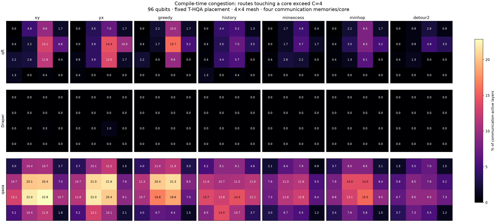
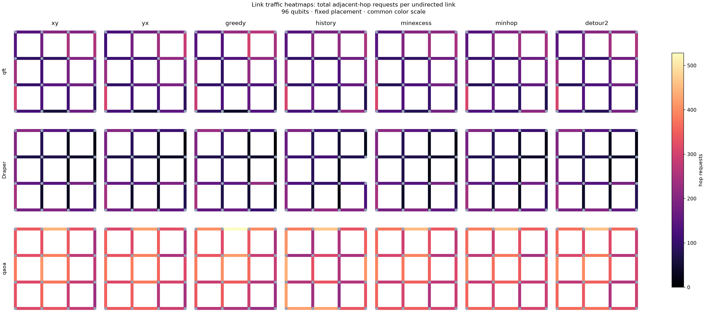

# Heavy-workload routing comparison — 2026-10-28

Lowest measured aggregate compiler makespan: **greedy**, ranked by the equal-workload geometric mean of makespan relative to XY.

This is an exploratory result for these three fixed 96-qubit placements, not a universal routing optimum. Each route was tested with simulator seeds 60–63 under both ODG and compiler C=4: 168 complete physical trials.

## Compiler logical migration latency (ms)

Mean ± sample standard deviation across four trials. A migration includes every sequential hop, admission waiting, reservation/control time, generation, retries and consumption. No pre-generation window is subtracted.

| Algorithm | qft | Draper | qaoa |
| --- | --- | --- | --- |
| xy | 1.1643 ± 0.0128 | 0.9385 ± 0.0046 | 2.5470 ± 0.5619 |
| yx | 1.1554 ± 0.0031 | 1.0670 ± 0.2335 | 2.2122 ± 0.0119 |
| greedy | 1.1551 ± 0.0109 | 0.9642 ± 0.0047 | 2.1608 ± 0.0256 |
| history | 1.0721 ± 0.0106 | 0.9163 ± 0.0066 | 2.1829 ± 0.1465 |
| minexcess | 1.0695 ± 0.0034 | 0.9380 ± 0.0069 | 2.3026 ± 0.2358 |
| minhop | 1.0184 ± 0.0062 | 0.9146 ± 0.0090 | 2.2724 ± 0.1599 |
| detour2 | 1.1208 ± 0.0080 | 0.9368 ± 0.0091 | 2.2469 ± 0.0441 |

## Compiler workload completion time (ms)

| Algorithm | qft | draper_qft_adder | qaoa |
| --- | --- | --- | --- |
| xy | 3272.51 | 3804.00 | 3987.84 |
| yx | 3284.96 | 3867.78 | 3789.36 |
| greedy | 3272.83 | 3813.36 | 3754.29 |
| history | 3223.78 | 3782.83 | 4011.56 |
| minexcess | 3222.18 | 3803.25 | 4042.01 |
| minhop | 3181.13 | 3776.43 | 3920.98 |
| detour2 | 3257.51 | 3801.53 | 3906.51 |

## ODG logical migration latency (ms)

| Algorithm | qft | draper_qft_adder | qaoa |
| --- | --- | --- | --- |
| xy | 2.4250 | 2.3664 | 2.8559 |
| yx | 2.4392 | 2.3683 | 2.8449 |
| greedy | 2.4312 | 2.3702 | 2.8006 |
| history | 2.4113 | 2.3744 | 2.8015 |
| minexcess | 2.4044 | 2.3641 | 2.7941 |
| minhop | 2.4061 | 2.3609 | 2.8013 |
| detour2 | 2.4281 | 2.3653 | 2.8278 |

## Trace congestion and route length

Excess = sum over all original layers and cores of max(0, number of routes touching core − 4). This is a compile-time demand proxy, not measured simultaneous occupancy.

| Workload | Algorithm | Hops | Route excess | Hop-incidence excess | Endpoint lower bound | MILP unproved layers |
| --- | --- | --- | --- | --- | --- | --- |
| qft | xy | 3833 | 184.0 | 875.0 | 11 | 0 |
| qft | yx | 3833 | 190.0 | 918.0 | 11 | 0 |
| qft | greedy | 3833 | 153.0 | 905.0 | 11 | 0 |
| qft | history | 3833 | 105.0 | 654.0 | 11 | 0 |
| qft | minexcess | 3833 | 65.0 | 696.0 | 11 | 0 |
| qft | detour2 | 3869 | 48.0 | 777.0 | 11 | 0 |
| draper_qft_adder | xy | 2661 | 1.0 | 50.0 | 0 | 0 |
| draper_qft_adder | yx | 2661 | 3.0 | 59.0 | 0 | 0 |
| draper_qft_adder | greedy | 2661 | 0.0 | 65.0 | 0 | 0 |
| draper_qft_adder | history | 2661 | 0.0 | 41.0 | 0 | 0 |
| draper_qft_adder | minexcess | 2661 | 0.0 | 50.0 | 0 | 0 |
| draper_qft_adder | detour2 | 2661 | 0.0 | 50.0 | 0 | 0 |
| qaoa | xy | 7913 | 1016.0 | 3580.0 | 100 | 0 |
| qaoa | yx | 7913 | 980.0 | 3568.0 | 100 | 0 |
| qaoa | greedy | 7913 | 834.0 | 3264.0 | 100 | 0 |
| qaoa | history | 7913 | 821.0 | 3155.0 | 100 | 0 |
| qaoa | minexcess | 7913 | 584.0 | 3064.0 | 100 | 0 |
| qaoa | detour2 | 8073 | 504.0 | 3191.0 | 100 | 0 |
| qft | minhop | 3833 | 115.0 | 498.0 | 11 | 0 |
| draper_qft_adder | minhop | 2661 | 0.0 | 12.0 | 0 | 0 |
| qaoa | minhop | 7913 | 722.0 | 2696.0 | 100 | 0 |

## Heatmaps and runtime plots

## Method and limits

- MQT Bench 2.3.0 circuits, 96 qubits each; normalized into rz/sx/x/cx at optimization level 0; T-HQA/OEE placement, mapping and circuit seed 42.
- Four-by-four mesh, 192 physical slots: eight data slots and four communication memories per core. Initial occupancy: 96 data qubits, 32 free data slots, 64 communication memories.
- Paths retain every migration endpoint, qubit, order and original circuit layer. Replay is checked against every layer of the complete placement matrix. No truncation or conflict-free batching is introduced.
- Compiler: all chain hops eligible for pre-generation, lead two layers, event admission, ready-first, native ownership handoff, no extra buffer. ODG gets the same four communication memories. Existing physical link configuration is fixed across all routes.
- Physical timing retains the existing layer barrier and empty-layer timing. Workload completion excludes offline mapping/routing computation; structural.csv separately reports route construction/export/validation wall time.
- Global MILP minimizes route-count excess (minexcess/detour2) or hop-incidence excess (minhop), with hops as tie breaker. All tested layers were solved to optimality within their candidate sets; this does not prove optimal runtime latency. Shortest+2 is a bounded search, not unrestricted routing.
- The measured waiting heatmap averages admission wait over incident hop requests and attributes each request to both endpoint cores. It is not a measured queue length or a causal attribution to the blocking endpoint. Link heatmaps show counts, not utilization.
- P95 in aggregate.csv is the average of the four trial p95s. Fidelity is delivered EPR fidelity per hop, not final circuit fidelity.
- Four simulator seeds characterize noise on one placement per circuit. These runs selected the recommendation; broader held-out placements and hardware parameters remain untested.

See aggregate.csv, runtime.csv, structural.csv, ranking.csv and inputs.json for numeric evidence. Each raw trial includes its exact command, metadata/source hashes, invariant audit, admission decisions and timing records.

## Fresh QAOA simulator-seed validation

After the seven-route comparison, XY and the two aggregate leaders (greedy and minhop) were tested on simulator seeds 64–67. Routes and weights were frozen. This adds 24 complete, audited trials (192 total). These remain the same QAOA circuit and placement; only the simulator randomness is held out.

| Algorithm | Policy | Mean hop (ms) | Mean migration (ms) | P95 migration (ms) | Completion time (ms) |
| --- | --- | --- | --- | --- | --- |
| xy | dynamic | 1.1139 | 2.2905 | 7.4502 | 3845.74 ± 44.68 |
| xy | on-demand | 1.3842 | 2.8464 | 6.7077 | 4075.58 ± 3.27 |
| greedy | dynamic | 1.0962 | 2.2542 | 7.6002 | 3795.71 ± 61.95 |
| greedy | on-demand | 1.3557 | 2.7879 | 6.4752 | 4028.50 ± 30.31 |
| minhop | dynamic | 1.0909 | 2.2433 | 7.5327 | 3786.96 ± 125.25 |
| minhop | on-demand | 1.3555 | 2.7874 | 6.5252 | 4050.13 ± 28.25 |
