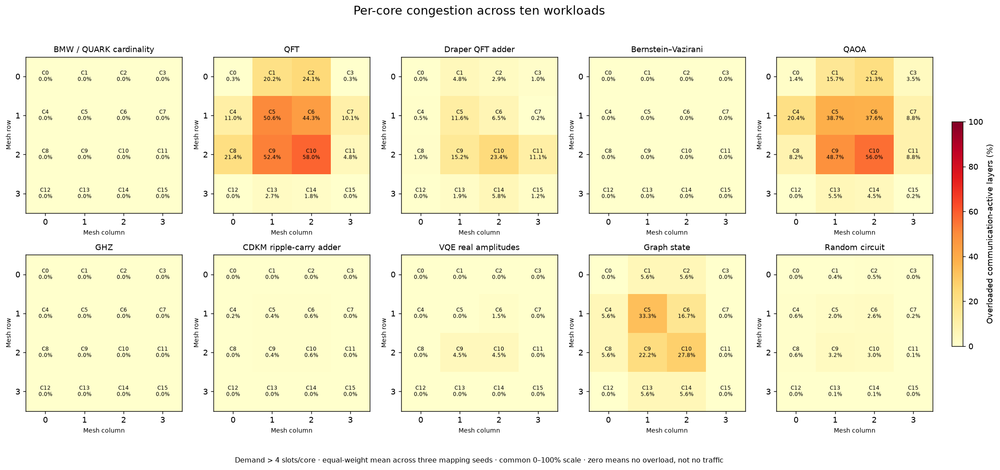

# Per-core congestion heatmap, regenerated from the raw traces (2026-10-24)



**Question.** Where on the 4x4 mesh does communication demand exceed the communication-memory capacity, and how
often? This is the structural picture behind the whole congestion study: it counts demand, it simulates no physics.

## Definition

* **Demand** of a core in a layer is the number of hops that touch it. Every hop in the traces joins two adjacent
  cores, so a hop is an endpoint incidence at both ends; a relayed move appears as several separate hops.
* A core is **overloaded** in a layer when its demand exceeds the capacity, here **4** communication slots.
* The percentage is overloaded layers divided by **communication-active layers** (layers with at least one request),
  so a core in a quiet circuit is not diluted by empty layers. Zero means no overload, not no traffic.
* Each cell is the equal-weight mean over the three mapping seeds (42, 43, 44) of the same circuit.

## Independence and verification

* Computed by `tools/heatmap/regenerate_heatmap.py` straight from the `requests.txt` of every trial in
  `results/congestion/mqt_ten_workload_congestion_results.zip` (SHA-256 `6654d4701e41d592c1af3570be6aa172271315499376c35913c9c004884f5990`), parsed with the validated reader
  in `tools/congestion_study`. The archive's precomputed congestion CSVs are not read, so this is an independent check.
* **All 160 cells (10 workloads x 16 cores) match the project's figure** (image dated 2026-10-21) at its printed
  0.1% resolution. The transcribed reference values live in `tools/heatmap/reference_image_values.py` and are pinned
  by `tools/heatmap/tests/test_heatmap.py`, which also checks the counting rule on a hand-made trace and that a larger
  capacity never increases overload.

## Summary (from the same computation)

Active layers and overloaded layers are listed for seeds 42/43/44.

| Workload | Active layers | Layers with any overload | Share of active layers | Hottest core (mean) |
|---|---|---|---|---|
| BMW / QUARK cardinality | 90/90/90 | 0/0/0 | 0.0% | C0 (0.0%) |
| QFT | 112/112/112 | 69/73/77 | 65.2% | C10 (58.0%) |
| Draper QFT adder | 138/138/138 | 54/54/63 | 41.3% | C10 (23.4%) |
| Bernstein–Vazirani | 16/16/16 | 0/0/0 | 0.0% | C0 (0.0%) |
| QAOA | 163/163/163 | 122/114/114 | 71.6% | C10 (56.0%) |
| GHZ | 15/15/15 | 0/0/0 | 0.0% | C0 (0.0%) |
| CDKM ripple-carry adder | 157/157/157 | 1/1/1 | 0.6% | C6 (0.6%) |
| VQE real amplitudes | 22/22/22 | 1/2/1 | 6.1% | C9 (4.5%) |
| Graph state | 6/6/6 | 2/2/2 | 33.3% | C5 (33.3%) |
| Random circuit | 2296/2296/2296 | 194/173/184 | 8.0% | C9 (3.2%) |

## Parameters, and how every number is calculated

**Inputs (what the trace gives).** Each `requests.txt` is one mapped circuit: the number of cores (16, a 4x4 mesh,
row-major so core 9 is row 2 column 1), data-qubit slots per core (8), the number of logical qubits (48 for QFT), the
initial placement `(qubit, core)`, and then, for each layer, the hops `(qubit, source core, destination core)`. A
**layer** is one step of the mapper: gates are scheduled as early as their dependencies allow (ASAP), and the qubit
placement is recomputed layer by layer, so the hops of a layer are the moves needed to get from one placement to the
next. A layer with no hops is *not* communication-active.

| Parameter | Value | Meaning | Where it comes from |
|---|---|---|---|
| Mesh | 4 rows x 4 columns, 16 cores | topology of the cores | fixed by the traces |
| Capacity | 4 | communication memories (qubit slots used for EPR pairs) per core; a core is "overloaded" above this | `--capacity`, default 4: the 4 communication qubits per core of the ACGP paper's Table I and the ACE default |
| Mapping seeds | 42, 43, 44 | three independent runs of the mapper on the same circuit | the three trials in the archive |
| Workloads | 10 | the ten circuits of the characterization | the archive |

**Step by step, for one workload and one core.**

1. *Demand per layer.* For layer L, count the hops whose source or destination is the core. A hop `(q, a, b)` adds 1 to
   core `a` and 1 to core `b`. (Every hop joins adjacent cores, so there is no separate relay term: a move across
   several cores was already split into one hop per link.) Call this `demand(core, L)`.
2. *Overloaded layer.* `demand(core, L) > capacity`. At capacity 4, a demand of 4 is not overloaded and 5 is.
3. *Active layers.* The layers of the trace that contain at least one hop, over the whole mesh. This is the denominator
   for every core, so all cells of one trial share it.
4. *Per-trial percentage.* `100 x (layers where the core is overloaded) / (active layers)`.
5. *Cell value.* The plain average of the three per-trial percentages (one per mapping seed). No weighting.

**Worked example: QFT, core C10.** Seed 42 has 382 layers, of which 112 are communication-active. C10 has demand above 4
in 64 of them, so 100 x 64 / 112 = 57.14%. Seeds 43 and 44 give 61.61% and 55.36%. Their mean is
(57.14 + 61.61 + 55.36) / 3 = **58.04%**, which prints as 58.0%, the C10 cell of the QFT panel. In seed 42 the
busiest layer is layer 176, where 20 hops touch C10 (for example qubit 9 moving 11 to 10 and then 10 to 9, qubit 13 moving
9 to 10 and then 10 to 6), five times the capacity.

**The summary table columns.** *Active layers* is step 3 for seeds 42/43/44. *Layers with any overload* counts layers in which
at least one core is overloaded (a different count from a single core's, so it is larger than any cell). *Share of active
layers* pools the three seeds: total layers with any overload over total active layers. *Hottest core* is the cell with the
largest mean.

**Colour and labels.** The colour scale is shared by all ten panels, from 0 to 100%, so panels can be compared by eye.
Each label is the core number and its mean to one decimal place; the figure compares to the reference at that resolution.

**What the number is not.** It is not latency, not a probability of failure and not a measure of relay load: it is the
share of communication-active layers in which a core is asked for more than 4 simultaneous pair endpoints. How much that
costs depends on the scheduler and the memory budget (`docs/reports/ace-budget-rerun.md`).

## Reading it

* Congestion concentrates on the central cores (C5, C6, C9, C10), which sit on the most shortest paths. QFT and QAOA
  are the heavy cases; GHZ, Bernstein-Vazirani and BMW never exceed 4.
* This says where demand is high, not what it costs. The cost under the corrected scheduler is in
  `docs/reports/ace-budget-rerun.md`.
* It uses the mapped traces as given; nothing about the mapping or routing is changed here.

## Files

| File | Contents |
|---|---|
| `per_core_congestion.png` | the figure |
| `per_core_percent.csv` | workload, core, equal-weight mean, and each seed's value (6 decimals) |

## Reproduce

```bash
python tools/heatmap/regenerate_heatmap.py --output out/heatmap
python -B -m unittest discover -s tools/heatmap/tests -p 'test_*.py'
```
